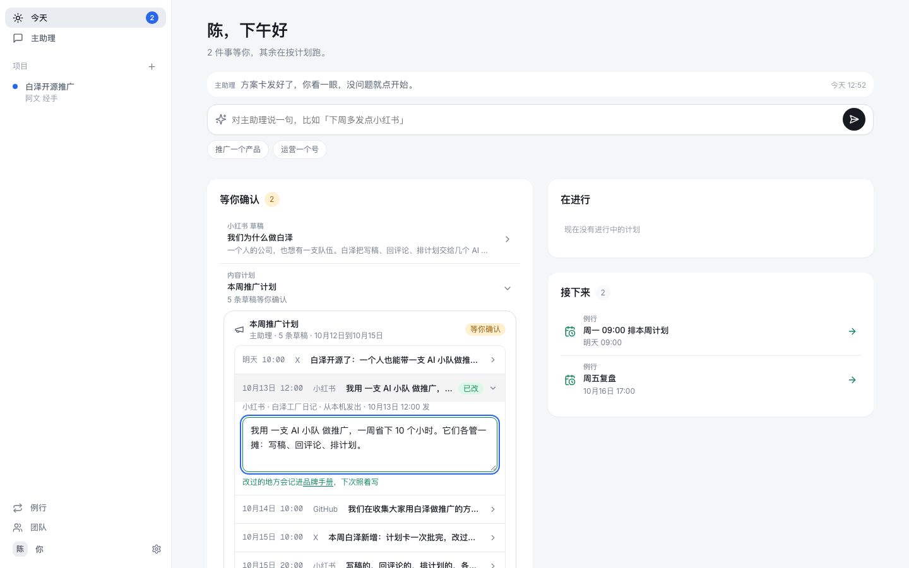
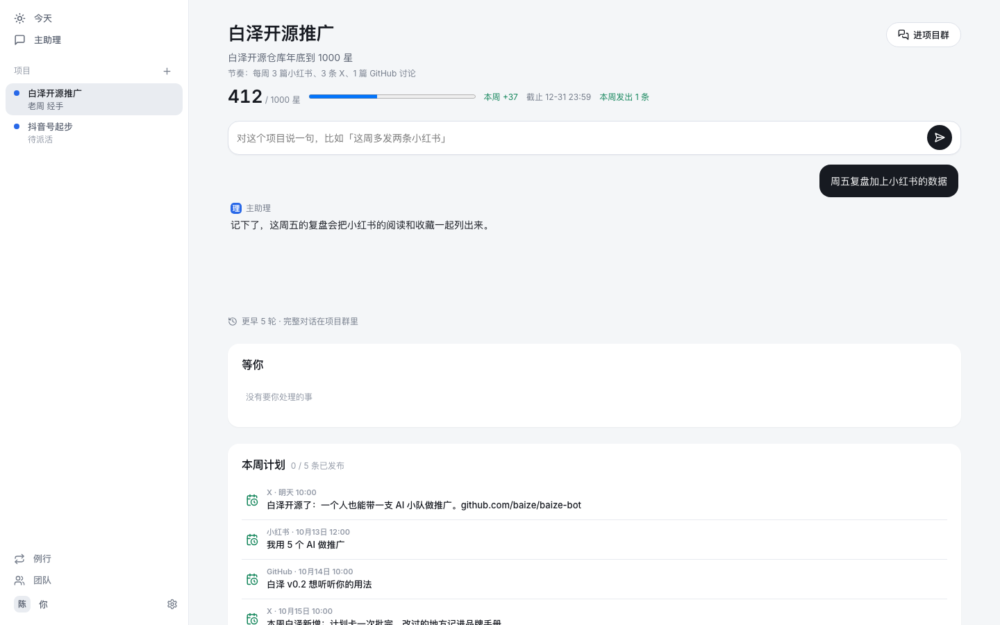
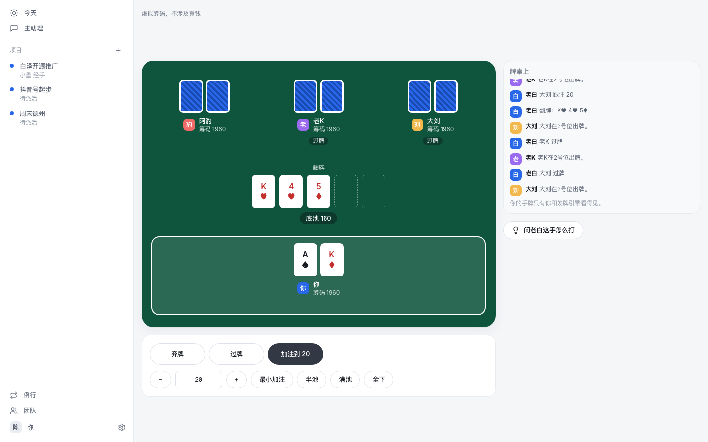

<p align="center"></p>

<h1 align="center">白泽 Bot</h1>

<p align="center"><a href="README.md">English</a> · <b>中文</b></p>

<div align="center">

[](https://github.com/SmartStudio/baize-bot/actions/workflows/ci.yml)
[](LICENSE)


</div>

**白泽 Bot 是一个带 Bot 团队干活的 AI 助理，本地优先，Bot 跑在你自己的电脑上。**

适合一个人或小团队做内容、社区和增长，比如推广一个开源仓库。你只跟主助理说话。它把活分给各个 Bot，只在要你拍板、做完有成果、卡住了这三种时候找你。帖子要你批准它本身或它所在的内容计划后才会发出去。

> 项目还在早期开发中，没有发布版本，也还没有下载地址。现在可以从源码在主干上跑起来。

<!-- TODO: demo GIF（首页说一句话 → 项目开起来 → 草稿等你批准） -->


### 三步从源码跑起来

需要 Node 22 以上、pnpm 和 Docker。

1. 克隆并配置：`git clone https://github.com/SmartStudio/baize-bot && cd baize-bot && pnpm install && cp .env.example .env`。在 `.env` 里填 `CREDENTIALS_KEY`（`openssl rand -base64 32`）和 `TOOL_SECRET_KEY`（`openssl rand -hex 32`），缺了控制面起不来。要让 Bot 调模型，再填 `UPSTREAM_API_KEY`。
2. 起数据库并初始化：`docker compose up -d`，再跑 `pnpm --filter @baize/control-plane migrate` 和 `pnpm --filter @baize/control-plane seed`。
3. 跑 `pnpm dev`，打开 http://localhost:5173，用 `chen@baize.dev` / `baize-dev` 登录。要连电脑代理，见 [docs/开发.md](docs/开发.md)。

想等到第一个发布版本，就点个 Star。这是我们判断有没有人需要它最直接的办法。

## 它能做什么

- **说一句话就开工。** 在首页告诉主助理你想做成什么事，比如「推广这个开源仓库」。它开一个项目，拉上合适的 Bot，写好计划。
- **一支 Bot 小队。** 主助理之外，每个队员 Bot 有自己的名字、描述、偏好和会做的事。多个 Bot 在同一个群里协作，@ 谁谁接活，没 @ 就由当前经手的 Bot 接着做。Bot 之间交接要写清做了什么、下一步是什么，对方确认了才换人。
- **项目有目标、有进度。** 每个项目顶部钉着一张任务卡，有清单、截止、目标数值和定时读回的指标，比如 GitHub 星数。
- **对外发布先给你看。** Bot 要发的帖子先成可编辑草稿。你可以一次批完一整份内容计划，之后按计划发出的每一条不再逐条问。草稿改过就回到待批。
- **敏感操作都要你点头。** Bot 走到要确认的工具时，群里出一张审批卡，点按钮或回一句「批准」都算数。
- **跑在你自己的电脑上。** 每人两台：本机 Mac 和一台远程云服务器。国内平台的账号放本机，GitHub、X 和资料搜集放远程，合上盖子活也照样跑。在对话里说一句「用云电脑」，Bot 就把这个群换过去接着做。云电脑上的命令跑在沙箱里。
- **连上你的账号。** GitHub 和 X 走 OAuth，凭据只存在控制面，Bot 拿不到。小红书在助理专用的浏览器里登录，登录页的实时画面送到网页上由你亲手操作。
- **越用越会。** Bot 干完一趟同类的活，会问要不要存成技能。也可以让它去 GitHub 上找公开的 SKILL.md 装进来。
- **例行任务。** 每天、工作日、每小时，或者由一个 webhook 触发，比如每晚的简报。
- **也能陪你玩。** 内置一张德州扑克牌桌，三个牌友 Bot 陪你打，打不准可以问解说。

## 截图

在首页一次批完一周的内容计划，发出前每条草稿都能直接改。


项目页上有目标和进度，比如年底到 1000 星，下面是本周计划。



德州扑克牌桌，三个牌友 Bot 陪你打。




## 怎么工作

```
Web / 桌面 App
   │
   ▼
控制面（账号、群、审批、草稿、模型网关）
   │  WebSocket
   ▼
你的电脑（本机 Mac / 远程云服务器）
   └─ 电脑代理 → 每个 Bot 每个群一份运行会话
```

控制面管状态和授权，活在你的电脑上跑。电脑主动连控制面，不需要开放入站端口。模型请求都经过控制面的网关转发。

## 快速开始

需要 Node 22 以上、pnpm 和 Docker。

```
pnpm install
docker compose up -d
pnpm --filter @baize/control-plane migrate
pnpm --filter @baize/control-plane seed
pnpm dev
```

打开 http://localhost:5173，用开发账号 `chen@baize.dev` / `baize-dev` 登录。

- 第一次使用：[docs/上手.md](docs/上手.md)
- 开发与环境变量：[docs/开发.md](docs/开发.md)
- 部署远程电脑：[deploy/README.md](deploy/README.md)
- 产品规格：[spec/规格.md](spec/规格.md)

## 技术栈

TypeScript pnpm monorepo。控制面用 Hono 和 PostgreSQL，Web 用 React 和 Vite，桌面端用 Electron，Bot 运行时基于 Pi coding agent。

## 开源协议

本项目以 [MIT 协议](LICENSE) 开源。
